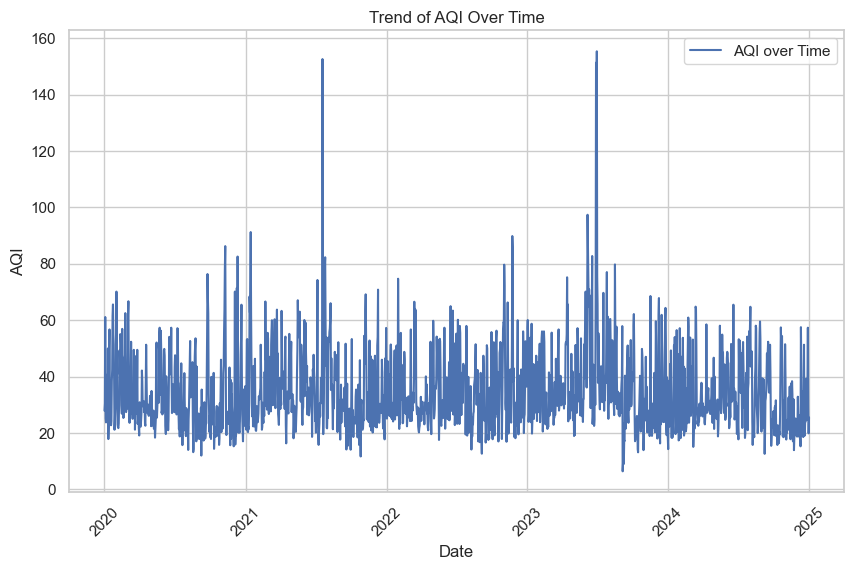
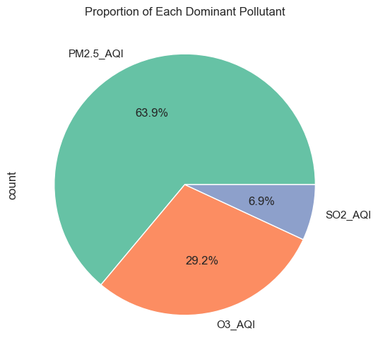

# Air Quality Forecasting — Toronto, 2020–2024

An environmental time-series project covering pollutant and weather data preparation, exploratory analysis, and forecasting. The original notebook compares statistical and machine learning models. A separate Python workflow evaluates forecasts using only information available before each target date.

[Analysis notebook](AirQuality.ipynb) · [Forecast workflow](forecast.py) · [Data requirements](docs/data.md) · [Evaluation notes](docs/evaluation.md)



*Saved notebook output, extracted without rerunning the source data. The derived index has unresolved averaging and breakpoint assumptions; this is an exploratory series, not a verified official AQI record.*

## What the project demonstrates

- Combining daily climate observations and hourly pollutant exports into a dated analytical dataset.
- Inspecting missing values, pollution spikes, seasonality, and relationships between pollutants.
- Comparing ARIMA, SARIMA, ETS, Prophet, linear regression, Random Forest, and XGBoost in the original exploration.
- Separating same-day index estimation from forecasting, with a chronological benchmark and simple baselines.

The practical question is whether past observations improve forecasts over repeating the latest reading or the previous week. The new workflow reports that comparison separately at horizons from one to seven days rather than assuming a complex model wins.

## Findings and interpretation

Saved notebook counts identify PM2.5 as the dominant component on **1,165 of 1,823 classified days (63.9%)**, followed by ozone and SO₂. This describes the notebook's derived index and available records; it is not an independent causal or official air-quality finding.



The earlier README's Random Forest RMSE of 7.59 and R² of 0.97 are **not retained as validated future-forecast performance**. The notebook mixes random splits, same-day pollutant predictors, time-series folds, and a comparison fitted on evaluation rows. Those scores do not provide an unbiased ranking of future forecasts. See [evaluation notes](docs/evaluation.md).

**Current limitation:** source CSVs are absent from this repository. The new workflow passes software tests on deterministic fixtures, but no new Toronto benchmark is claimed until the observations and target construction are verified.

## Run the forecasting workflow

Use Python 3.11+ from the repository root:

```bash
git clone https://github.com/AhmedOT22/Air-Quality-Forecasting.git
cd Air-Quality-Forecasting
python -m venv .venv
# macOS/Linux:
source .venv/bin/activate
# Windows PowerShell instead: .venv\Scripts\Activate.ps1
python -m pip install -r requirements-tested.txt
python forecast.py --input data/daily_aqi.csv --test-days 90 --horizon 7
```

Supply `Date,AQI`: one finite, non-negative observed value per consecutive calendar day. Extra columns are ignored. Missing dates, duplicate dates, missing targets, and invalid values are rejected rather than silently imputed. See [the data contract and original file layout](docs/data.md).

The benchmark fits before the final 90 days. At each eligible holdout origin it issues a recursive seven-day forecast. Actuals become available between origins, never inside a forecast trajectory. Model weights stay fixed throughout evaluation. Features use historical AQI and known calendar terms, with no future pollutant/weather observations.

### Generated outputs

| File under `reports/latest/` | Contents |
| --- | --- |
| `metrics.csv` | MAE/RMSE per horizon for Random Forest, persistence, and weekly seasonal naïve |
| `backtest.csv` | Origin, target date, horizon, actual, and each model's prediction |
| `backtest.png` | One-day predictions versus observations on eligible holdout origins |
| `forecast.csv` | Future forecast after a separate refit on all supplied observations |
| `run.json` | Input checksum, date boundaries, settings, Python/package versions |

No synthetic example results are presented as Toronto measurements. The final refit does not change holdout scores. `requirements-tested.txt` captures tested package versions; `requirements.txt` gives broader compatible ranges.

## Tests

```bash
python -m unittest discover -s tests -v
```

Tests cover past-only features, independence from unrevealed labels, date boundaries, baseline alignment, invalid inputs, and output files. These validate software behavior, not environmental forecast accuracy. A GitHub Actions workflow runs the same tests on pushes and pull requests.

## Original notebook

`AirQuality.ipynb` preserves the original analysis and outputs with its evaluation limitations documented here. To explore it, install `requirements-notebook.txt` in a separate Python 3.11 environment and run `jupyter lab`. It requires untracked climate/pollutant exports and a processed intermediate CSV. That older dependency environment has not been rerun end to end here.

`calculation.py` retains the original index formulas. Before using them for a new benchmark, verify station identifiers, units, averaging periods, missing-hour coverage, concentration truncation, and the intended historical breakpoint standard. This project does not establish equivalence with Canada's AQHI or provide public-health guidance.

## Tools

Python, pandas, NumPy, scikit-learn, and Matplotlib in the standalone workflow; statsmodels, Prophet, XGBoost, and Seaborn in the original notebook.

Developed by [Ahmed Ouazzani](https://github.com/AhmedOT22).
