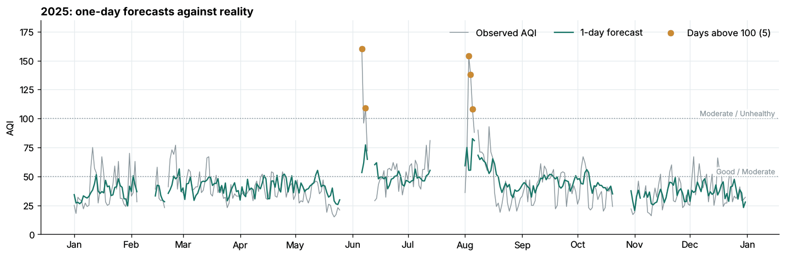

# Toronto Air Quality Forecasting

[](https://github.com/AhmedOT22/Air-Quality-Forecasting/actions/workflows/tests.yml)

**Daily Air Quality Index (AQI) forecasts for Toronto, 1–7 days ahead — trained,
tested on a held-out year, and published automatically twice a day.**

Python · pandas · scikit-learn · Streamlit · GitHub Actions


The system builds a daily AQI from public government monitoring data, picks a model
with leak-free time-series testing, then issues a new 7-day forecast twice a day and
scores each one once the real value is known.

**Start here:** the [notebook](AirQuality.ipynb) tells the whole story in ten short
sections, from the raw data to where the model fails. The **latest live forecasts**
are in [`reports/operational/`](https://github.com/AhmedOT22/Air-Quality-Forecasting/tree/data/reports/operational)
on the `data` branch.

## Results

The model is **Ridge regression** (one per forecast horizon). It was chosen using
2022–2024 data, frozen, and then tested once on **2025**, a year it never saw:

| Days ahead | Forecast error | Naive guess error | Less error | Right AQI category |
| --- | ---: | ---: | ---: | ---: |
| 1 | **10.8** | 14.9 | **27%** | **76%** (naive 68%) |
| 3 | **12.5** | 15.6 | **20%** | **73%** (naive 65%) |
| 7 | **12.2** | 16.4 | **26%** | **74%** (naive 61%) |

Errors are mean absolute error in AQI points, over 306–314 days per horizon. The
naive guess, "same as the latest known day", is the standard benchmark a forecast must
beat; Ridge beats it at every horizon from 1 to 7 days.

**Where it fails: pollution spikes.** Like most regression models, it pulls forecasts
toward typical values. It runs about 12 points high on the cleanest days and far too
low on the worst ones: every 2025 day above AQI 100 that it forecast came out below
100. The worst misses were sudden PM2.5 spikes, the signature of wildfire smoke, which
local data cannot see coming.



**Also found:**
- **Fine particles drive bad days.** PM2.5 decided 83% of days above AQI 50 in the
  exploration years; ozone matters on some summer days.
- **Recent AQI only helps for a few days.** One day out, the forecast leans on the latest
  reading and wind speed; from about three days out, time of year and the 7-day average
  take over ([`reports/explain/`](reports/explain/)).
- **The model types finished close together.** Ridge, random forests and gradient
  boosting were within a few tenths of a point on 2022–23; Ridge is the simplest of
  near-equals ([`reports/workflow/`](reports/workflow/)).
- **The 90% range is honest.** Each forecast's range is set from the model's errors
  over the last 180 days. Checked on 2026, it contained the real value 89.8–90.8% of the
  time at each horizon ([`reports/uncertainty/`](reports/uncertainty/)).

## How it works

```text
Federal (NAPS) + Ontario pollution data, Environment Canada weather
                       │
        Validated ETL → daily 4-pollutant AQI (EPA 2024 rules)
                       │
       Checksummed, locked research snapshot
                       │
  Compare models (2022–23) → tune (2024) → final test (2025)
                       │
     GitHub Actions: refresh data twice daily, issue a 7-day forecast
                       │
  Forecast ledger (data branch) → score once observations arrive
                       │
                Streamlit dashboard
```

**Engineering highlights**

- **No look-ahead leakage.** Features only use data available at forecast time,
  including the one-day delay before the ozone part of the AQI is final. Missing
  weather is filled using training data only, and tests check that changing future
  values never changes a past forecast.
- **Tested against baselines, in time order.** Five model types were compared with two
  naive baselines on identical dates, using expanding yearly folds rather than random
  splits; the chosen model was frozen before the final test year.
- **Reproducible data.** A versioned data contract, SHA-256 checksums and source
  manifests lock the research snapshot. Missing AQI is never filled in.
- **Built for production.** Each forecast is recorded once and never overwritten; stale
  or incomplete inputs block publication instead of reusing old data; every forecast
  carries the model version that made it.
- **Tested.** 66 unit and integration tests cover AQI calculation, leakage, scheduling
  and the dashboard; CI also re-runs the notebook.

## Project layout

| Path | Purpose |
| --- | --- |
| [`AirQuality.ipynb`](AirQuality.ipynb) | The narrative: data, model choice, 2025 results, failures, latest forecast |
| `aqi.py`, `aqi_data.py`, `data_sources.py`, `extend_data.py` | Download pollution and weather data; calculate daily AQI |
| `etl_contract.py` | Validate and lock the prepared dataset |
| `features.py`, `workflow.py` | Leak-free features; model comparison, tuning and the 2025 test |
| `uncertainty.py` | 90% forecast ranges from recent errors (rolling conformal intervals) |
| `explain.py` | What drives each horizon's forecast (permutation importance) |
| `operations.py` | Scheduled refresh: issue, record and score forecasts |
| `forecast_weather.py`, `weather_model.py` | Experimental challenger using weather forecasts |
| `app.py`, `dashboard_data.py` | Streamlit dashboard |
| `reports/` | Saved results: `workflow/`, `explain/`, `uncertainty/`, `weather/`, and a bundled `operational/` copy |
| `data/processed/` | Locked, checksummed input data |
| `tests/`, `scripts/` | Test suite; notebook runner used by CI |
| `docs/` | Detailed methods (linked below) |

## Run locally

Python 3.11, from the repository root:

```bash
python -m venv .venv
source .venv/bin/activate            # Windows: .venv\Scripts\activate
pip install -r requirements.txt
```

```bash
streamlit run app.py                 # open the dashboard
python -m unittest discover -s tests # run the test suite
```

Reproduce the results (each command rewrites its `reports/` folder; outputs should
match the committed files byte for byte):

```bash
python workflow.py                   # model comparison, tuning and the 2025 test
python explain.py                    # what drives the forecast
python uncertainty.py                # 90% range calibration
```

For the notebook, also run `pip install -r requirements-dev.txt`, then
`jupyter lab AirQuality.ipynb` (or `python scripts/execute_notebook.py` to re-run it
headless, as CI does). Live refreshes run in GitHub Actions; see
[Operations](docs/operations.md).

## Limitations

- **Spikes and smoke.** The model misses sudden pollution spikes, especially
  long-range wildfire smoke, which no local input can see.
- **Single station.** Forecasts cover the Toronto West monitor, with weather from
  Pearson airport about 8 km away. Recent Ontario readings are provisional.
- **Not an official index.** The AQI is rebuilt with US EPA 2024 rules from four
  pollutants (PM2.5, ozone, NO₂, SO₂). It is not Canada's AQHI or health advice.
- **Live track record is still building.** The 2025 results are a historical test.
  Live accuracy appears on the dashboard once each horizon has 30 scored forecasts.
- **Ranges are estimates.** The 90% coverage is back-tested, not guaranteed; live
  coverage is scored separately. The weather-forecast challenger is monitored on its
  own and never replaces the main model automatically.

## Documentation

[Evaluation protocol](docs/workflow.md) · [Data & AQI calculation](docs/data.md) ·
[Data contract](docs/etl_contract.md) · [Data sources](docs/extended_data.md) ·
[Source comparison](docs/source_comparison.md) · [Operations](docs/operations.md) ·
[Dashboard](docs/dashboard.md)

**Data:** Environment and Climate Change Canada (NAPS, Meteorological Service of Canada)
and the Government of Ontario, under the
[Open Government Licence – Canada](https://open.canada.ca/en/open-government-licence-canada).
Forecast weather from [Open-Meteo](https://open-meteo.com/) (CC BY 4.0).

Developed by [Ahmed Ouazzani](https://github.com/AhmedOT22).
