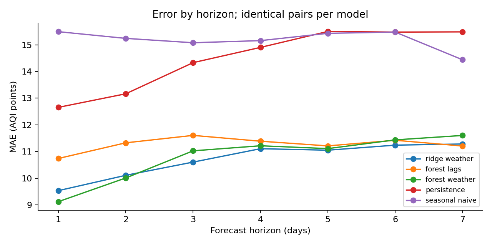

# Toronto Air Quality Index Forecasting

Forecasting **AQI** from PM2.5, ozone, NO₂ and SO₂ at Toronto West. This restores
the original project objective, using documented NAPS hourly observations and ECCC
weather for **2020–2024**.

[Executed AQI notebook](AirQuality.ipynb) · [Source quality assessment](docs/source_comparison.md) ·
[Data and index definition](docs/data.md) · [Evaluation](docs/evaluation.md)



## Target and source

The target is an **EPA-based four-pollutant AQI reconstruction**, on the familiar
AQI index scale. The same four pollutants as the original project are retained.
This is not PM2.5 concentration, Canada's AQHI, or an official published city AQI.
CO and PM10 are outside the original four-pollutant scope and are not silently claimed
as included.

The default uses fixed **EPA 2024 breakpoints** across all archive years. The
pandas pipeline rebuilds component indices, the combined AQI, categories and dominant
pollutants from hourly observations. `AQI_epa_2018` preserves the earlier definition
as a comparison column. This is a retrospective harmonization, not a claim that
2024 breakpoints were used in historical government reports.

- PM2.5: 24-hour mean; NO₂: daily maximum 1-hour value.
- SO₂: maximum 1-hour value at lower levels, with the documented 24-hour high-level rule.
- Ozone: maximum eligible 8-hour mean, plus the applicable 1-hour sub-index.
- Concentrations are truncated at the specified precision; sub-indices use linear
  interpolation and integer half-up rounding. AQI is the maximum of all four indices.
- A missing component makes the combined AQI unavailable; no missing target is imputed.

The prepared snapshot has **1,827 calendar days**, **1,709 complete AQI targets**,
and **118 missing targets**. Source metadata, methods, download times and checksums
are committed. The raw national files are cached locally and excluded from Git.

## Does the new source improve the original project?

NAPS provides documented quality-assured measurements and reproducible provenance.
However, the old raw CSVs are absent, so we cannot certify superiority over the
exact original files or claim a source-only accuracy gain. They may originate
from the same monitoring network. See the [explicit comparison](docs/source_comparison.md).

The evidence below evaluates **AQI forecasts**, not concentration forecasts. The
old notebook's saved scores are not comparable because its index construction,
missingness handling, and evaluation were different.

## AQI forecasting results

MAE is in **AQI points**, lower is better. Model settings are fixed; each year is
evaluated with a fit using only earlier available targets. Models share the same
eligible origin/target pairs within each horizon.

| Year | Horizon | Eligible forecasts | Ridge + weather | Forest + weather | Index-only forest | Persistence | Weekly naïve |
| --- | --- | ---: | ---: | ---: | ---: | ---: | ---: |
| 2023 | 1 day | 247 | 13.984 | 14.456 | 15.217 | 17.283 | 20.980 |
| 2023 | 7 days | 232 | 16.045 | 15.443 | 15.305 | 21.707 | 22.418 |
| 2024 | 1 day | 308 | 9.533 | 9.119 | 10.739 | 12.656 | 15.494 |
| 2024 | 7 days | 302 | 11.282 | 11.602 | 11.206 | 15.487 | 14.440 |

The weather-assisted forest improves one-day MAE over persistence by **27.9% in
2024**. Ridge improves one-day MAE by **19.1% in 2023**. These are improvements over
the same-source persistence baseline, **not evidence of improvement over the old dataset**.
No model is claimed to be universally best.

Ozone windows can extend into the following morning. Therefore AQI inputs and
training labels are delayed **one full calendar day** in the backtest. Forecasts
issued after completed day t use AQI no later than t−1 and predict t+1 through t+7.
Weather features describe completed day t. This avoids using an AQI that was not
available at the simulated forecast origin.

## Run the pipeline

Use Python 3.11+ from the repository root:

```bash
python -m venv .venv
# macOS/Linux
source .venv/bin/activate
# Windows PowerShell: .venv\Scripts\Activate.ps1
python -m pip install -r requirements-tested.txt

# Default task is AQI: download all four pollutants, validate and reconstruct index
python data_sources.py
python forecast.py --output reports/aqi/2024
python forecast.py --end-date 2023-12-31 --test-days 365 --output reports/aqi/2023
python -m unittest discover -s tests -v
```

The committed daily AQI snapshot enables forecasting offline. To intentionally
refresh provider versions, use `python data_sources.py --refresh` and regenerate
the results. To reconstruct the alternative fixed breakpoint version, use
`--aqi-standard epa_2018 --output data/processed/daily_aqi_2018.csv`; do not compare
its scores directly with another target definition as if only the data source changed.

For the notebook:

```bash
python -m pip install -r requirements-notebook.txt
jupyter lab AirQuality.ipynb
```

The notebook uses the same functions. Its cells are verified sequentially with
captured actual outputs through `python scripts/execute_notebook.py`. The execution
environment blocks Jupyter kernel sockets, so kernel startup itself is not verified.

## Project structure

| Path | Purpose |
| --- | --- |
| `data_sources.py` | Download/cache entry point; AQI is the default task |
| `aqi_data.py` | Station-specific four-pollutant hourly preparation and AQI dataset |
| `aqi.py` | Versioned sub-indices, averaging windows, completeness and AQI combination |
| `forecast.py` | Availability-aware direct forecasting and chronological backtests |
| `data/processed/daily_aqi.csv` | AQI, component indices, concentrations, coverage and weather |
| `data/processed/daily_aqi.manifest.json` | Source provenance and explicit target definition |
| `reports/aqi/2023/`, `reports/aqi/2024/` | AQI predictions, metrics, plots, run settings |
| `analysis/PM25.ipynb` | Separate supplementary concentration analysis |
| `reports/2023/`, `reports/2024/` | Earlier PM2.5-only results, not AQI results |
| `notebooks/legacy/` | Original exploration and formulas, retained for history |

## Limits and attribution

This is a single-site reconstruction with four pollutants, not a government-issued
Toronto AQI or health advisory. Strict completeness and missing SO₂ observations
reduce eligible days, especially in 2023. Instrument methods change within the
period. Weather at Pearson is approximately 7.9 km from the pollution monitor.
Overlapping forecasts are dependent; no statistical significance, calibrated
uncertainty intervals or extreme-event warning capability is claimed.

Source observations: Environment and Climate Change Canada, NAPS and Meteorological
Service of Canada, accessed October 31, 2026. NAPS data are under the
[Open Government Licence – Canada](https://open.canada.ca/en/open-government-licence-canada).
No government endorsement is implied.

Developed by [Ahmed Ouazzani](https://github.com/AhmedOT22).
