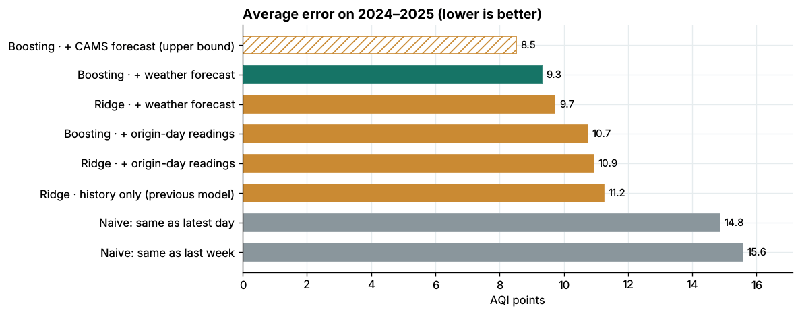
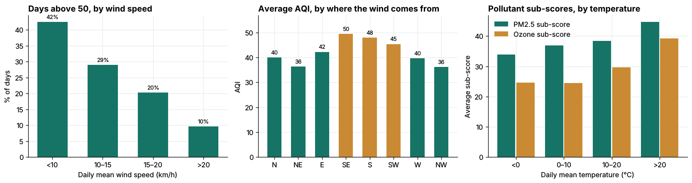
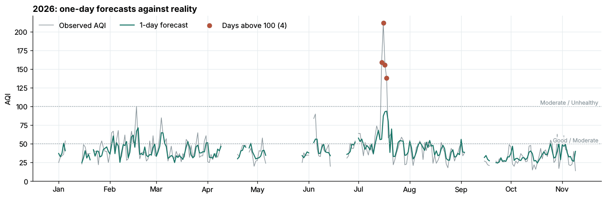

# Toronto Air Quality Outlook

[](https://github.com/AhmedOT22/Air-Quality-Forecasting/actions/workflows/tests.yml)

**A 7-day air-quality outlook for Toronto that says what to expect, how sure it is,
and when to change your plans.**

Python · pandas · scikit-learn · Streamlit · GitHub Actions


## The problem

People with asthma, parents, coaches and outdoor workers plan days ahead, but
official air-quality forecasts in Canada look only about two days out. This project
forecasts the daily Air Quality Index (AQI) at the Toronto West monitor **1 to 7 days
ahead** and turns each forecast into a decision aid:

- a **forecast** and the **range** the real value should fall in 9 days out of 10;
- the **chance** the day ends above AQI 50 (Moderate) or 100 (unhealthy for
  sensitive groups);
- a plain **flag**: good for outdoor plans, heads-up, or unhealthy-air alert.

It refreshes itself twice a day, records every forecast permanently, and scores each
one once the real value is known.

**Start here:** the [notebook](AirQuality.ipynb) tells the whole story with charts.
The **latest live outlook** is in
[`reports/operational/`](https://github.com/AhmedOT22/Air-Quality-Forecasting/tree/data/reports/operational)
on the `data` branch.

## Results

The model was chosen on 2024–2025 and then tested once on **2026**, a year it never
saw (January 1 to November 9, every model scored on the same days):

| Days ahead | This model | Previous model | Naive guess | Less error than naive | Right AQI category |
| --- | ---: | ---: | ---: | ---: | ---: |
| 1 | **8.8** | 11.7 | 16.2 | **45%** | **84%** (naive 69%) |
| 3 | **10.9** | 12.5 | 17.4 | **37%** | **76%** (naive 66%) |
| 5 | **11.7** | 13.2 | 17.6 | **34%** | **79%** (naive 65%) |
| 7 | **12.3** | 13.2 | 18.8 | **35%** | **76%** (naive 66%) |

Errors are the average miss in AQI points (lower is better). The naive guess is "same
as the latest known day", the standard benchmark a forecast has to beat.

**As a decision aid (2026):**

- **Flags caught 82% of days above AQI 50**, 86% one day ahead. About half of
  one-day flags and a third of longer-range flags were right, so a flag means "poorer
  air is plausible, check again tomorrow", and no flag is reliable good news.
- **The chances mean what they say:** when the outlook gave a 25–50% chance of
  exceeding 50, it happened 35% of the time; above 75%, 81% of the time.
- **The likely range held** 90–92% of outcomes at every horizon.
- **Days above 100:** 3 of 4 were flagged the day before with no false alarms, and
  none two or more days ahead (see Limits).

## What the study found

**1. Better inputs beat better algorithms.** Each step up this ladder is a new
input, not a fancier model. Readings already in hand and a weather forecast cut error
by 13% against the previous model; swapping the model type alone changed it by 2–4%.



**2. Wind, heat and season explain ordinary days.** On calm days 42% exceed AQI 50;
on windy days 10%. Air from the south is about 12 points dirtier than air from the
north. That is why the weather forecast for the target day is the main driver of the
outlook from two days out.



**3. Tomorrow depends on today's fine particles.** The latest day's PM2.5 is known
before its final AQI is (ozone is averaged past midnight). Using it cut one-day error
by about 18%.

**4. Wildfire smoke explains the extremes, and is the limit.** 15 of the 19 days
above AQI 100 since 2020 had smoke reported at Pearson airport that day or the day
before. Smoke arrives from hundreds of kilometres away, so local readings show it at
most a day ahead.



**5. A smoke forecast is the next real gain.** Adding the European CAMS air-quality
forecast cut back-test error further (9.6 against 11.1), but its archive only keeps
near-term values, so that figure is an upper bound. It runs live as a challenger, and
the refresh records real CAMS forecasts by lead time so honest evidence builds up.

## How it works

```text
 Pollution (NAPS, Air Quality Ontario)      Weather (Environment Canada)
 Weather forecasts by lead time, CAMS air-quality forecasts (Open-Meteo)
                              │
          Validated, checksummed, locked dataset
                              │
   Compare candidates (2024–25) → tune → freeze → test once (2026)
                              │
   Likely range · chance of AQI above 50 / 100 · flag cut-offs
                              │
   GitHub Actions, twice daily: refresh data, issue the outlook,
   record it permanently, score earlier forecasts
                              │
                    Streamlit dashboard
```

**Engineering highlights**

- **No look-ahead leakage.** Every input is something known when the forecast is
  issued, and the back-test uses the weather forecast as it stood 1–7 days earlier.
  Tests check that changing future values never changes a past forecast.
- **Honest selection.** Candidates are compared on later years in order, the winner
  is frozen, and the test year is scored once. An input that cannot be verified from
  archives (CAMS) is reported as an upper bound and cannot be selected.
- **Reproducible.** The dataset is checksummed and locked; one command regenerates
  every report byte for byte.
- **Built for production.** Each forecast is recorded once and never overwritten,
  unready inputs block publication instead of reusing old data, and each forecast
  carries a model version that changes only when the model does.
- **Tested.** 75 unit and integration tests; CI re-runs the pipeline and the notebook.

## Run it

Python 3.11, from the repository root:

```bash
python -m venv .venv
source .venv/bin/activate            # Windows: .venv\Scripts\activate
pip install -r requirements.txt
```

```bash
streamlit run app.py                 # open the dashboard
python -m airquality pipeline        # train, calibrate, score decisions, explain (~2 min)
python -m unittest discover -s tests # run the test suite
```

Everything goes through one entry point, `python -m airquality <command>`:

| Command | What it does |
| --- | --- |
| `pipeline` | Runs `train`, `intervals`, `decisions` and `explain` in order |
| `train` | Compares candidates, tunes and freezes the winner, tests it on 2026 |
| `intervals` | Calibrates the 90% likely range |
| `decisions` | Chances of exceeding AQI 50 and 100, flag cut-offs and their scores |
| `explain` | Measures what each horizon's forecast relies on |
| `data`, `lock` | Re-download the sources and rebuild the dataset; freeze it for modelling |
| `refresh` | The scheduled job: issue today's outlook and score earlier ones |
| `notebook` | Re-runs `AirQuality.ipynb` in place (needs `requirements-dev.txt`) |

## Project layout

| Path | Purpose |
| --- | --- |
| [`AirQuality.ipynb`](AirQuality.ipynb) | The analysis: drivers of air quality, model choice, results, decisions. Reads saved results only |
| `airquality/sources.py`, `naps_aqi.py`, `extend.py`, `aqi.py` | Download pollution and weather data; calculate the daily AQI |
| `airquality/forecast_inputs.py` | Weather forecasts by lead time and CAMS air-quality forecasts |
| `airquality/contract.py` | Validate and lock the dataset |
| `airquality/features.py`, `training.py` | Leak-free inputs; candidate comparison, tuning and the test |
| `airquality/uncertainty.py`, `decisions.py`, `explain.py` | Likely range; chances and flags; what the model relies on |
| `airquality/operations.py` | Scheduled refresh: issue, record and score forecasts |
| `app.py`, `airquality/dashboard_data.py` | Streamlit dashboard |
| `data/processed/` | Locked dataset and forecast archives |
| `reports/` | Saved results: `model/`, `uncertainty/`, `decisions/`, `explain/`, and a bundled copy of the live `operational/` ledger |
| `tests/`, `docs/` | Test suite; guides and reference notes |

## Limits

- **Smoke.** The outlook cannot see wildfire smoke coming more than a day ahead. In
  wildfire season, no flag a few days out is not reassurance; follow official smoke
  advisories.
- **Few extreme days.** Only four days exceeded AQI 100 in the test year, so
  statistics about them are indicative.
- **One monitor.** Forecasts cover Toronto West, with weather from Pearson airport
  about 8 km away. Recent Ontario readings are provisional.
- **Not an official index.** The AQI is rebuilt with US EPA 2024 rules from four
  pollutants. It is not Canada's AQHI or health advice.
- **Live record is still short.** The 2026 results are a back-test. Live accuracy
  appears on the dashboard once each horizon has 30 scored forecasts.

## Documentation

- [Data](docs/data.md): sources, what is collected and how to rebuild it
- [Modelling](docs/modelling.md): candidates, selection protocol, results, decisions
- [Operations](docs/operations.md): the scheduled refresh, the forecast ledger, deploying the dashboard
- Reference: [AQI calculation](docs/reference/aqi_calculation.md) ·
  [data contract](docs/reference/data_contract.md) ·
  [Ontario extension](docs/reference/ontario_extension.md) ·
  [source comparison](docs/reference/source_comparison.md)

**Data:** pollution (NAPS) and weather data from Environment and Climate Change Canada,
under the [Open Government Licence – Canada](https://open.canada.ca/en/open-government-licence-canada);
2025-onward pollution data from the Government of Ontario
([Air Quality Ontario](https://www.airqualityontario.com/), subject to its
[terms and disclaimer](https://www.airqualityontario.com/science/disclaimer.php));
weather and air-quality forecasts from [Open-Meteo](https://open-meteo.com/) (CC BY 4.0),
including CAMS data from the Copernicus Atmosphere Monitoring Service.

**Licence:** code under the [MIT License](LICENSE); data remains under its sources' terms.

Developed by [Ahmed Ouazzani](https://github.com/AhmedOT22).
