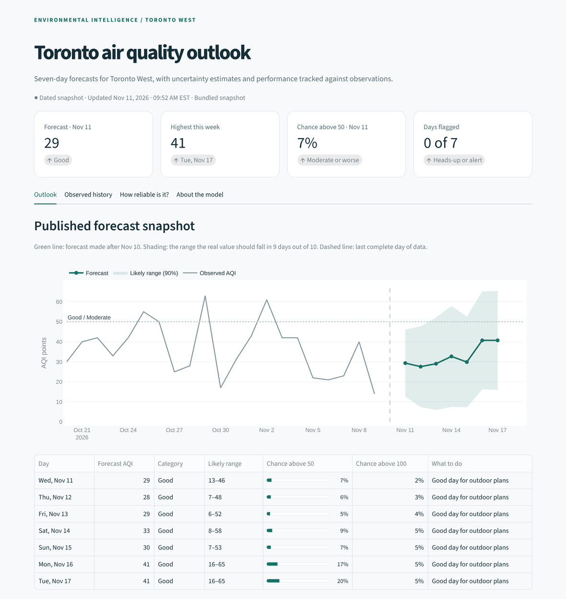

# Toronto Air Quality Forecasting

**Daily AQI forecasts for Toronto, 1–7 days ahead — trained, evaluated and published automatically.**

Python · pandas · scikit-learn · Streamlit · GitHub Actions



An end-to-end forecasting system: it builds a daily Air Quality Index from public
government monitoring data, selects a model with leakage-free time-series validation,
then issues new forecasts twice a day and scores each one against what actually happened.

## Results

The selected model, **Ridge regression** (one model per horizon), was chosen on
2022–2024 data and then evaluated once on the held-out year **2025**:

| Horizon | Ridge MAE | Persistence MAE | Error reduction |
| --- | ---: | ---: | ---: |
| 1 day | **10.8** | 14.9 | **27%** |
| 3 days | **12.5** | 15.6 | **20%** |
| 7 days | **12.2** | 16.4 | **26%** |

MAE is in AQI points on 306–314 matched dates per horizon. "Persistence" repeats the
latest known AQI — the standard baseline a forecast has to beat. Ridge beats it at every
horizon from 1 to 7 days. Full tables: [`reports/workflow/`](reports/workflow/).

**Gradient boosting** competed as a candidate and lost the 2022–23 comparison (MAE 12.80
vs 12.48), so Ridge stays. On 2025, a tuned boosting model would have scored slightly
better on average (11.76 vs 11.93), winning at 6 of 7 horizons, but the rule picks models
on earlier years only, so that is reported rather than acted on
([`boosting_challenger.csv`](reports/workflow/boosting_challenger.csv)).

**What drives a forecast.** Permutation importance on 2025 shows the latest AQI and wind
speed dominate 1-day forecasts, while the 7-day mean and time of year take over from
3 days out ([`reports/explain/`](reports/explain/), chart on the dashboard).

**Prediction intervals.** Each forecast carries a rolling conformal 90% interval, set
from the last 180 days of out-of-sample errors. Chosen on 2025 and checked on 2026, it
covered 89.8–90.8% of outcomes per horizon, up from 79–87% with the previous fixed
calibration ([`reports/uncertainty/`](reports/uncertainty/)).

## How it works

```text
Federal (NAPS) + Ontario pollution data, ECCC weather
                       │
        Validated ETL → daily 4-pollutant AQI (EPA 2024)
                       │
       Checksummed, locked research snapshot
                       │
  Model comparison (2022–23) → tuning (2024) → final test (2025)
                       │
     GitHub Actions: refresh data twice daily, issue 7-day forecast
                       │
  Forecast ledger (data branch) → score once observations arrive
                       │
                Streamlit dashboard
```

**Engineering highlights**

- **No look-ahead leakage.** Features only use data that would have been available at
  forecast time, including the one-day delay before ozone-based AQI is final. Scaling
  and imputation are fitted on training data only, and tests assert that changing
  future values never changes a past prediction.
- **Baseline-driven model selection.** Linear autoregression, Ridge, random forests and
  gradient boosting were compared against persistence and weekly-repeat baselines on identical dates,
  using expanding yearly folds rather than random splits.
- **Reproducible data.** A versioned ETL contract, SHA-256 checksums and source
  manifests lock the research snapshot. Missing AQI is never imputed.
- **Production behaviour.** Each forecast is recorded once and never overwritten,
  stale inputs block publication instead of silently reusing old data, and every
  forecast is tagged with the model version that produced it.
- **Tested.** 65 unit and integration tests cover AQI calculations, leakage,
  scheduling and the dashboard; CI also re-executes the analysis notebook.

## Project layout

| Path | Purpose |
| --- | --- |
| [`AirQuality.ipynb`](AirQuality.ipynb) | Research notebook: data, EDA, model selection, evaluation |
| `aqi.py`, `aqi_data.py`, `data_sources.py`, `extend_data.py` | Data acquisition and AQI calculation |
| `etl_contract.py` | Validates and locks the prepared dataset |
| `features.py`, `workflow.py` | Leakage-aware features, model selection and evaluation |
| `operations.py` | Scheduled refresh, forecast issuance and scoring |
| `app.py`, `dashboard_data.py` | Streamlit dashboard |
| `uncertainty.py` | Rolling conformal prediction intervals |
| `explain.py` | Permutation importance: what drives each horizon's forecast |
| `weather_model.py` | Experimental weather-forecast challenger |

## Run locally

Python 3.11, from the repository root:

```bash
python -m venv .venv
source .venv/bin/activate            # Windows: .venv\Scripts\activate
pip install -r requirements.txt

python workflow.py                   # reproduce model selection and the 2025 test
python -m unittest discover -s tests # run the test suite
streamlit run app.py                 # open the dashboard
```

For the notebook, install `requirements-dev.txt` and run `jupyter lab AirQuality.ipynb`.

## Limitations

- **Single station.** Forecasts cover the Toronto West monitor, using Pearson airport
  weather as a proxy.
- **Not an official index.** The AQI is reconstructed with US EPA 2024 breakpoints
  from four pollutants (PM2.5, O3, NO2, SO2). It is not Canada's AQHI or a health advisory.
- **Live track record is still building.** The 2025 numbers above are a historical
  test. Live accuracy appears on the dashboard once each horizon has 30 scored forecasts.
- **Intervals are calibrated, not guaranteed.** Errors are serially dependent and
  conditions shift, so 90% coverage is a back-tested estimate; live coverage is scored
  separately. The weather-forecast challenger is monitored on its own and never
  replaces the main model automatically.

## Documentation

[Evaluation protocol](docs/workflow.md) · [Data & AQI calculation](docs/data.md) ·
[ETL contract](docs/etl_contract.md) · [Data sources](docs/extended_data.md) ·
[Source comparison](docs/source_comparison.md) · [Operations](docs/operations.md) ·
[Dashboard](docs/dashboard.md)

**Data:** Environment and Climate Change Canada (NAPS, Meteorological Service of Canada)
and the Government of Ontario, under the
[Open Government Licence – Canada](https://open.canada.ca/en/open-government-licence-canada).
Forecast weather from [Open-Meteo](https://open-meteo.com/) (CC BY 4.0).

Developed by [Ahmed Ouazzani](https://github.com/AhmedOT22).
